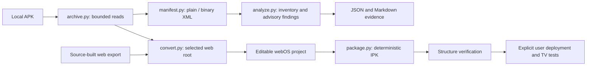

# Architecture

`viewer.py` is the no-entry fallback. It generates an explicitly labelled content viewer and namespaced copies of selected resources. It can produce an IPK without pretending that Android code was translated. `convert.py` records `mode: generated-content-viewer` and `original_android_app_functionality: false` for this path.

`cli.py` and `gui.py` share the same analysis, project creation and packaging functions. GUI work runs on a worker thread and delivers results through a queue; Tk updates remain on the UI thread.

`recover.py` discovers alternate HTML entries, identifies Android-dependent HTML templates, and can construct the missing HTML document around an existing browser JavaScript entry. Generated-document provenance is included in the conversion report. This layer does not translate native code or implement Android bridges.

APK extraction selects a literal archive prefix; no APK code is executed. Paths and sizes are checked before reads. Native runtime artifacts outside the selected web root are recorded rather than copied into an allegedly converted runtime. Every selected web file is copied byte-for-byte except generated/updated `appinfo.json`. Unknown asset types are retained; dependency findings do not filter content.

Output construction happens in a new temporary sibling directory. Only after packaging and structural checks succeed is it renamed to the requested new output path. Existing outputs are refused to preserve prior work. Failures remove only the temporary directory owned by the operation.

The built-in packager writes `debian-binary`, `control.tar.gz` and `data.tar.gz` inside an ar archive. The data tree includes `usr/palm/applications/<id>/` and `usr/palm/packages/<id>/packageinfo.json`. Timestamps, modes and archive order are fixed; gzip timestamps are zero. Repeated builds are deterministic within a given Python/zlib environment. Cross-version compression bytes can differ.

`verify_ipk` checks container extents, required archives, safe members, one app, metadata consistency, entry and icon existence. It does not execute JavaScript, validate all optional metadata, validate image decoding, grant API permissions, prove runtime compatibility or establish LG Store eligibility.
